# InvoiAI — Production Roadmap

> **Status:** Product and engineering plan, based on a static source review on 2026-10-31. It is not a claim that the deployed database, payment provider, OAuth connections, secrets, or live integrations have been verified. Read this before changing product behavior, routes, schemas, services, workers, billing, or UI.

## Confirmed product decisions — source of truth

These decisions were confirmed by the product owner through the InvoiAI grill and subsequent scope amendments. The latest 2026-11-07 amendments below supersede conflicting Round 9–12 country and accounting-provider decisions. The international financial operations blueprint remains the long-range architecture reference; this section governs MVP scope. Re-read it before planning or changing product scope.

- **Markets and customers:** The UK and US are the primary launch markets. Target small and medium-sized professional-services firms, consultancies, agencies, and finance teams already processing supplier invoices. Do not block signup, invoice intake, review, approval, or payment-instruction export solely because a customer is Nigerian or has not connected accounting software. Preserve NGN invoice amounts; if a provider cannot accept a currency or market-specific posting, explain the limitation and leave the customer able to complete the supported manual workflow. Validate local billing and tax needs before claiming full Nigeria localization.
- **Accounting integrations:** Xero, QuickBooks Online, and Sage Accounting are MVP integrations, available to UK and US customers. Reuse the current QuickBooks integration rather than rebuilding it and complete Xero's missing launch workflow. For Sage AP, focus on User Accounts, Contacts, Chart of Accounts, Purchase Transactions, Status Codes & Types, Currencies, Taxes, and relevant Settings; Attachments are optional if copying the invoice file into Sage is needed. Verify the exact API version, region, and required permissions. Banking, Payments & Receipts, general Transactions/journals, Sales, Opening Balances, Products & Services, and Reporting are out of scope. Customers without a connected or compatible provider must still be able to use the manual AP workflow.
- **Currency:** Default UK workspaces to GBP and US workspaces to USD. Preserve every invoice's original amount and ISO currency. Do not silently convert foreign-currency amounts; route conversion or provider-specific accounting treatment to human review until verified against each connected accounting provider. Validate NGN invoice capture and posting behavior with Nigerian customers before claiming NGN accounting localization. Defer advanced FX conversion and multi-currency reporting.
- **MVP workflow:** Self-service workspace registration; secure PDF/image upload plus a per-organization forwarding address; extraction and deterministic validation; duplicate and anomaly flags; supplier and GL coding; two-way and three-way matching with partial invoices/deliveries and configurable tolerances; human review and approval with amount limits; approved-bill creation in the workspace's selected accounting system; payment-instruction export; and manual payment-status tracking. Gmail and Microsoft 365 mailbox connections are deferred.
- **Purchase orders:** Import POs from the selected accounting provider when connected. Without a connection, allow basic manual creation or CSV import. The connected accounting provider remains source of truth for its POs. Goods receipts are captured in InvoiAI. Support partial deliveries, partial invoices, configurable tolerances, and line-level allocation across POs and receipts; route discrepancies to human review. A successful match never auto-approves. Defer procurement request/PO authoring and full sourcing management.
- **Human control and roles:** AI extracts, checks, and recommends; authorized people make final coding, approval, tax, and payment decisions. Keep three simple roles (workspace admin, invoice reviewer, approver); a person may hold multiple roles. Preserve actor, time, changes, and outcomes in the audit history. Changes to critical financial fields revoke approval and require reapproval.
- **Exceptions and records:** Suspected duplicates are flagged for human resolution, never silently rejected or deleted. Do not permanently delete approved or synced invoices through normal workflow; allow authorized void/archive with reason and audit history. A bill in any connected accounting provider may require a separate accounting action; InvoiAI must not imply that voiding locally reverses it.
- **Payments:** InvoiAI will prepare payment instructions but will not hold funds, execute supplier payments, or initiate transfers in the MVP. Provide CSV and printable PDF exports, plus manual status updates labelled customer-reported. Do not claim a manual “paid” status is independently verified. Keep vendor-payment execution disabled; a real payment provider is not an MVP launch prerequisite.
- **Dashboard:** Provide an operational AP queue with search, filters, counts, and clear exception/next-action states for review, approval, accounting sync, payment tracking, duplicates, PO discrepancies, voided, and archived records. Defer advanced analytics and custom reports.
- **AI and tax:** Use the existing production AI provider with suitable privacy and human-review safeguards. Validate outputs deterministically. Extract invoice tax/VAT amounts and check arithmetic; do not determine tax treatment, file returns, or claim jurisdiction-wide compliance.
- **Subscription:** Use a workspace subscription with a monthly invoice-processing allowance and a number of included user seats. Price UK plans in GBP and US plans in USD based on pilot feedback and operating costs; additional seats are an add-on. Stripe is for InvoiAI subscription billing only, subject to account, currency, and market eligibility checks. A US Stripe account does not make supplier-payment execution part of the product. Warn before the allowance; at the limit pause new AI processing without surprise overage charges, while preserving access to existing records. No permanent free tier: the approved trial is 14 days, up to 25 processed invoices, no card at signup, then read-only plus export if no paid plan is chosen.
- **Pilot and onboarding:** Run a discounted pilot with invited UK and US businesses using accounting software, and include Nigerian customer discovery where it can validate the requested QuickBooks/Sage coverage. State the local-currency post-pilot price before enrollment. Measure workflow completion, extraction corrections, time saved, sync reliability by provider, repeated usage, satisfaction, processing costs, and willingness to pay. After the pilot, offer self-service onboarding with optional connection and data-import help.
- **Cancellation:** Let customers export invoices, extracted data, and audit history; provide a clearly explained read-only period before deletion. Set final retention/deletion periods only after legal-adviser review.

### Round 9 decisions — blueprint reconciliation (2026-11-06)

- **Build authority:** This roadmap is the binding launch contract. The international financial operations blueprint is the long-range architecture reference. Where they conflict, this roadmap governs launch scope.
- **Launch modules:** Accounts Payable only. AR is deferred until paying AP customers demonstrate demand.
- **Target customer:** UK professional-services firms, consultancies, and agencies with roughly 5–50 employees, already using Xero and processing supplier invoices manually. Require 15–25 customer interviews and 3–5 pilot businesses before treating market assumptions as validated.
- **Accounting integration:** Xero only. QuickBooks stays inactive and additional integrations are deferred.
- **Payment boundary:** No payment initiation, execution, or provider integration in the MVP. Payment preparation, CSV export, printable instructions, and customer-reported status with audit history only. Mock providers stay disabled in production. Payment-provider selection is not on the MVP critical path.
- **Xero write-back is launch scope:** Customer-selected tenant, supplier and chart-of-accounts sync, approved-bill creation, idempotency, duplicate prevention, retries, and visible error recovery. Import POs only if PO matching remains in the agreed MVP workflow. Verify end to end in a Xero sandbox before pilot invoices are processed.
- **Security gates:** Tenant isolation, RLS on tenant-owned tables, server-side authorization, and cross-tenant tests across API paths, background jobs, exports, document storage, and search. MFA required for organization owners and administrators before pilot onboarding.
- **Data location and retention:** Prefer a UK or suitable EU hosting region and confirm the actual Supabase region before pilot onboarding. Document data flows, subprocessors, transfers, and safeguards. Ship customer export, read-only access to retained records, and deletion workflows. Do not invent retention periods; obtain qualified advice.
- **AI:** OpenAI is the sole production provider at launch. Retain the provider configuration but build no automatic multi-provider routing. Require data-processing terms, data minimization, human review, deterministic validation, and provider/model/version/latency/cost logging. AI never approves invoices, executes payments, changes bank details, or posts accounting entries.
- **Billing entity:** Final choice deferred among the Nigerian entity, a UK Ltd, a US LLC, and a merchant-of-record. Obtain qualified legal and tax advice and verify provider eligibility, banking, settlement, and invoicing before activating live checkout. Remove the free-tier price ID; there is no permanent free tier at launch.
- **Verification:** CI results are the only accepted evidence of passing tests. Fix collection failures and pin a reproducible development and CI environment. Add tenant-isolation, RLS, Decimal/rounding, duplicate-bill retry, webhook replay, migration, and backup-restore tests.
- **Positioning:** "AI-assisted AP automation for UK businesses that process supplier invoices and sync approved bills to Xero." Do not claim to be a complete accounting system, double-entry ledger, tax-filing platform, certified e-invoicing solution, or universally compliant international financial platform. Defer the full accounting ledger.

### Round 10 decisions — complete AP MVP (2026-11-06)

- **Launch gate is the complete AP MVP:** upload and forwarding-email intake; supplier invoices, credit notes, POs, and goods receipts; two-way and three-way matching with partial invoices/deliveries and configurable tolerances; simple limit-based approvals with reapproval on critical changes; Xero approved-bill write-back; payment-instruction export; UK/EU hosting; and the Round 9 security gates. Do not publicly launch a reduced matching workflow.
- **Matching:** support two-way and three-way matching, configurable per organization and transaction. An invoice may reference zero, one, or many POs/receipts. Partial deliveries and partial invoices allocate at line level by quantity and amount. Tolerances are configurable. A match never auto-approves; mismatches enter the exception queue and may be waived only by an authorized approver with a reason and audit event.
- **Goods receipts:** Xero has no goods-receipt object, so receipts are captured in InvoiAI by manual entry and CSV import at launch. Xero remains source of truth for POs. No mobile receiving, barcode scanning, or inventory-system integration at launch.
- **Intake:** upload plus a per-organization forwarding address so suppliers keep using the customer's existing email address. Gmail and Microsoft 365 mailbox OAuth is deferred. Email attachments pass the same type validation, quarantine, hashing, and duplicate detection as uploads.
- **Document scope:** supplier invoices and credit notes; POs and goods receipts as matching evidence. Other document types stay out of the AP pipeline at launch, even if classification can label them.
- **Approvals:** reviewers and approvers with amount limits; higher-value invoices require an additional approval; changes to critical financial fields revoke approval and require reapproval. Advanced matrices, custom routing, and per-department policies are deferred.
- **Vendor portal:** not in the MVP. Supplier data is managed internally with permissions and audit history. Supplier self-service and bank-detail collection are deferred.
- **Personal finance:** not part of the MVP and must not share navigation, context, or data paths with business AP.
- **VAT:** extract and validate VAT rates, amounts, and invoice arithmetic; map tax information to Xero. No tax determination, returns, or MTD filing.
- **Pricing hypotheses:** £149/month including 200 processed invoices and £299/month including 600 are hypotheses, not final prices. Discounted pilot. No free plan. At the allowance, pause new AI/OCR processing while preserving manual management, approval, export, Xero sync, and access to existing records. The tier structure is superseded by the 2026-11-08 team-pricing amendment; these figures remain only as historical willingness-to-pay hypotheses.
- **Pilot metrics:** measured as rates against the actual enrolled cohort, not an assumed five businesses. Track Xero sync success, duplicate bills (target zero), extraction correction rate, invoice-to-approval time versus the customer's baseline, willingness to pay at the stated price, and AI/OCR cost as a share of subscription revenue.
- **Hosting and retention:** UK region preferred, with an EU fallback if UK is unavailable. Tenant isolation, private storage, backups, monitoring, and tested recovery are launch gates. Customers can export on exit; a defined read-only period precedes deletion; deletion follows the approved retention policy and legal advice.

### Round 11 decisions — MVP execution constraints (2026-11-06)

- **Completeness over date:** Do not cut AP functionality to meet an arbitrary launch date. Run a two-week technical spike, then derive the timeline from evidence. Capacity and budget must be established before any delivery date is committed; no fixed two-week or calendar deadline is assumed.
- **Spike scope:** (1) an approved invoice creates an idempotent bill in a Xero sandbox; (2) a partial receipt allocates against a PO line; (3) an inbound email becomes the same document record as an upload. The spike result sets the plan and the date.
- **Matching gate:** unmatched or out-of-tolerance invoices block approval by default. An authorized approver may waive with a written reason, recorded as an audited exception. Defaults: price tolerance 2% or a configurable absolute cap, quantity tolerance 0% for three-way unless a partial receipt exists, and exact tax-total match. Every tolerance and waiver is configurable and audited. A match never auto-approves.
- **Goods receipts:** organizations can enable or disable receipt requirements. Authorized users record receipts manually or by CSV; partial receipts accumulate against PO lines. Allocated receipts cannot be silently edited; voiding requires a reason and an audit event. No mobile receiving, barcode scanning, or inventory integration in the MVP.
- **Email intake:** one secure forwarding address per organization; email invoices enter the same workflow as uploads. SPF/DKIM/DMARC failures quarantine for human review instead of silent acceptance or rejection. Attachment scanning, rate limits, secure inbound processing, and cross-channel duplicate detection are required. Postmark is the initial candidate subject to suitability and cost; Gmail and Microsoft 365 remain deferred.
- **Critical fields and limits:** post-approval changes to supplier identity, invoice number/date, currency, total, tax, line amounts, GL coding, or PO/receipt allocation revoke approval. Limits are in workspace currency; foreign-currency invoices use the invoice-date rate and are flagged for FX review. The submitter cannot approve above £500; owner/admin self-approval below £500 is allowed with an audit event.
- **Allowance behaviour:** at the invoice allowance, pause only new AI/OCR extraction. Manual creation and editing, approval, Xero sync, payment export, and access to existing records continue. Warn at 80% and 100%. No automatic overage charges or account lockout.
- **Pilot metrics:** use actual enrolled and active cohorts. Active = at least 10 invoices in the trailing 14 days. Gates: Xero sync ≥99%, duplicate bills zero, median corrected header fields ≤1.5, corrected line items ≤15%, processing-time improvement ≥50% versus the interview baseline, willingness to pay ≥75% of active pilots, AI/OCR/infrastructure cost ≤20% of subscription revenue, and cohort completion ≥75% processing 20 invoices within four weeks.
- **Hosting and cancellation:** London if Supabase supports it; otherwise Ireland or Frankfurt. Confirm the actual region before production provisioning. After cancellation: 30 days read-only plus full export, then deletion under the approved retention policy and legal requirements.
- **Personal finance:** code retained, feature disabled, removed from navigation, dashboard routes redirected, APIs not exposed in the business workspace, and no data mixing.
- **Xero tenant:** one tenant per workspace at launch, selected at connection. Changing tenant after bills exist requires admin confirmation and a sync check. Xero remains PO source of truth; a PO change after allocation flags the match for review without silently changing or recreating the allocation.

### Round 12 decisions — authentication and business onboarding (2026-11-06)

- **Authentication scope:** signup with name, business email, and password; Google sign-in and signup; six-digit OTP email verification with resend, expiry, and attempt limits; email/password login; forgot-password and secure reset; logout and session management; MFA for administrators. Email verification is a separate control from administrator MFA.
- **Onboarding scope:** after verification, a guided business-workspace setup collects business name, country, industry, headcount, approximate monthly supplier-invoice volume, accounting software, and the user's business role. Optional questions can be skipped, and answers can be edited later in settings.
- **Workspace model:** a user account can belong to a business workspace; a workspace supports multiple users. Initial signup creates the first workspace and assigns the creator owner/admin permissions. Identity, membership, and business data stay separate, and authorization is enforced server-side.
- **Frontend is in scope:** authentication and onboarding are not delivered as backend-only endpoints. Forms, validation, OTP state, Google button, redirects, workspace switcher, member management, error/loading states, and accessibility must be wired end to end.
- **Caching:** no tokens or secrets in client storage. The BFF keeps an encrypted httpOnly session cookie and authenticated responses use `no-store`. Server state is cached with React Query using organization-scoped keys and explicit invalidation. Redis caches reference data with organization-scoped keys, short TTLs, and invalidation on writes. Never cache OTPs, sessions, raw documents, OAuth tokens, or authorization decisions beyond a short, explicitly invalidated TTL.
- **Acceptance:** signup and OTP verification work end to end; Google OAuth works; login, logout, forgot, and reset work; unverified accounts cannot reach protected business functionality; onboarding and workspace creation work; multiple users hold appropriate permissions; cross-tenant access is denied; administrator MFA is enforced; organization switches and logout clear cached business data.

### Product-owner amendment — market and accounting integrations (2026-11-07)

This amendment set UK and US as the primary markets and restored QuickBooks to the MVP. The later Sage API scope amendment below narrows which Sage capabilities are included. Nigeria is an important customer context and should not be blocked solely by geography or provider choice, but Nigeria-specific tax, billing, and currency support must be validated before claiming full local readiness.

- Preserve and reuse the existing QuickBooks code. Complete the Xero path already under development. The source audit found no Sage OAuth/client/sync implementation.
- The application contains substantial QuickBooks integration code (including OAuth, mapping, sync, and an approved-bill path) and partial Xero integration code. Neither has been live-verified in this source audit.
- Use GBP as the UK workspace default and USD as the US workspace default. Preserve original invoice currency/amount, including NGN. Verify currencies and bill-write behavior separately for each accounting provider; keep unsupported conversion cases in human review and do not block the remaining AP workflow.
- Configure subscription billing for UK/US currencies only after verifying the existing Stripe account's eligibility and product configuration. Supplier payment execution remains out of scope.
- The reconciliation of `docs/AP_MVP_IMPLEMENTATION_SPEC.md` to the limited Sage Accounting AP scope was completed in the 2026-11-08 revision, together with the 33-ticket proposal.

### Product-owner amendment — Sage AP API scope and low-compliance boundary (2026-11-07)

The product owner has confirmed Sage remains in the MVP alongside Xero and QuickBooks Online, using the AP-related Sage Accounting API areas listed in the confirmed product decisions above. This does not authorize a broad Sage banking, payment, journal, tax-filing, or reporting integration. Keep supplier-payment execution and bank-account access out of scope; InvoiAI prepares bills for the customer's accounting system and payment instructions for the customer to execute. Verify Sage API version, regional availability, authorization requirements, and supported currency behavior before implementation. Do not imply that limiting payment functionality removes all company, data-protection, tax, contract, or provider obligations; confirm launch requirements with qualified advisers.

**Sage test environment (confirmed 2026-11-08):** Sage Business Cloud Accounting API has **no development sandbox**. Use **Sage Accounting API 3.1** against a **Sage trial business account** for all Sage read/write evidence. Do not use Sage Active, Sage 50, or Sage Intacct. Keep Xero and QuickBooks Online sandbox requirements unchanged. Before presenting an edition as AP-compatible, verify from official documentation and the trial business whether the exact **Sage Start** edition supports supplier purchase transactions; a quotes-and-invoicing-only edition is not AP-compatible.

**Scope guardrail:** Keep supplier payment execution, payment-provider selection, AR, automated tax determination/filing, e-invoicing/fiscalization adapters, a double-entry ledger, multi-entity consolidation, advanced FX, advanced approval matrices, multi-provider AI routing, a permanent free tier, supplier self-service and bank-change collection, Gmail/Microsoft 365 mailbox OAuth, enterprise SSO/SCIM, personal finance, mobile receiving/barcode scanning, inventory integration, and procurement request/PO authoring out of scope unless pilot evidence justifies them. Keep the AP MVP complete; do not add architecture solely for hypothetical future flexibility.

### Product-owner amendment — signup, team pricing, and frontend direction (2026-11-08)

**Pricing and team access**

- Each plan bundles a monthly **workspace invoice-processing allowance** and a number of **included user seats**. Seat limits and invoice allowances are independent; exceeding one does not change the other.
- **Approved starting structure:** **Solo** — 1 active seat; **Duo** — 2 active seats; **Team** — 5 active seats. Additional seats are a paid add-on. Final prices, invoice allowances, additional-seat rates, and proration remain unapproved and must not be invented or published.
- A seat is one unique active workspace member. Holding several roles never consumes more than one seat. Pending invitations, removed members, and disabled members do not consume a seat.
- Additional seats are a paid add-on at the plan's per-seat rate. Before inviting, the workspace shows included seats, used seats, pending invitations, and the next charge.
- The invoice allowance counts invoices entering the AP pipeline per billing period. It does not count supplier payments, approvals, exports, or teammate activity. InvoiAI prepares payment instructions but does not execute payments, so billing never depends on payment count.
- Keep GBP plans for UK workspaces and USD plans for US workspaces. Nigeria billing and Stripe eligibility are a separate verification item; Nigerian customers are never blocked from signup or manual AP.
- Remove the permanent Free plan at launch. **Approved trial:** 14 days, up to 25 processed invoices, no payment card at signup, then read-only access plus export if the customer has not chosen a paid plan. This is a time-limited trial, not a free plan. Keep paid checkout gated until the owner approves actual amounts.
- Keep the existing Workspace Admin, Invoice Reviewer, and Approver roles, teammate invitations, and approver assignment during onboarding.

**Signup and business onboarding**

- Use a short **account-registration step** followed by a **resumable business-onboarding flow**. Do not put every question on one long registration form.
- Registration collects first name, surname, business email, and password or Google signup. Mobile phone is optional at registration and is collected in onboarding or security settings for recovery and notifications.
- Business onboarding collects workspace name, country and default currency with user override, accounting software (Xero, QuickBooks Online, Sage Accounting, none, not sure), business type or registration status including “not yet registered”, industry, team size, approximate monthly invoice volume, and optional teammate invitations with admin/reviewer/approver roles. Omit referral-code collection unless an existing launch purpose is confirmed.
- Never require a company registration number or tax ID to create an account, start a trial, or use manual AP. Tax-registration details are requested later only where billing (for example VAT) or a specific accounting setup requires them, and stay optional otherwise.
- Country sets currency, date, and number formatting defaults only. It never determines tax treatment, creates a tax obligation, or files anything. Users keep control of tax choices and accounting mappings.
- Email OTP remains the primary verification path. Mobile number alone must not block signup. Evaluate SMS OTP as an optional recovery or second-factor channel, not a mandatory parallel step; compare cost, country coverage, and signup friction before adding it. Nigeria must complete signup and manual AP when SMS is unavailable.
- Show the supported Sage Accounting product/edition during connection setup. “Sage Accounting Start (Quotes & Invoicing Only)” must not be presented as AP-compatible unless official documentation and a Sage trial business account verify supplier purchase-transaction support.

**Frontend direction**

- Use **UI/UX Pro Max** for the authenticated product UI and **Scroll Craft** for the public landing/pricing journey where it fits. Scroll-driven storytelling is public-only.
- Desired direction: premium, distinctive, polished; restrained glass surfaces, glossy color accents, and a few dimensional moments; smooth, purposeful transitions of roughly 150–250 ms.
- Use Lottie only for meaningful onboarding, success, or empty states — never for every icon, table row, approval, or money value.
- Invoice tables, forms, review, and approval screens stay high-contrast, calm, fast, and easy to scan. Do not place glass blur behind dense text or financial values.
- Respect keyboard access, screen readers, reduced-motion preferences, mobile layouts, and performance. Reuse the existing Next.js, Tailwind, Radix, Lucide, React Query stack; add no 3D or animation dependency without a specific need. Existing remote Lottie embeds must be replaced with local, licensed, lazy-loaded assets or removed if they fail performance or privacy review.

**Source-audit note (2026-11-08):** signup collects email and password only; verification is link-based, not six-digit OTP; `/onboarding` does not exist and workspace creation lives at `/workspace`; the invite UI exposes owner/admin/manager/member; `seat_limit_for` is defined but unused, so seats are not enforced; Stripe checkout sends quantity 1 with no trial; the plan catalog is USD-only and still includes a permanent Free tier; the public pricing page advertises “Start free”; fonts are DM Sans and Playfair Display, not the earlier Lexend/Source Sans 3 baseline.

## Executive summary

InvoiAI already contains a broad AP foundation: organization/workspace context, document intake, OCR/extraction, validation, vendors, purchase orders, receipts, matching, coding, approval controls, payment instructions, accounting integrations, billing, notifications, analytics, and a personal-finance area. This is substantial existing work; production planning should harden and connect it instead of replacing it with another architecture.

The clearest blockers in the current source are: deployed schema/migration authority is not proven; accounting integration coverage for the UK/US MVP is incomplete; Sage Accounting API regional availability, authorization, and resource behavior need verification against API 3.1 using a Sage trial business account (Sage has no development sandbox); line-item and capture changes still require staged database verification; user-facing route flows need consistent search/status/next-action behavior; and production OAuth, access isolation, provider sync, and operational recovery must be verified end to end. Supplier payment execution is outside the MVP and must remain disabled.

The product should guide a small finance team through **receive → review/correct → code/match → approve → create a bill in the selected accounting system → prepare payment instructions → track customer-reported payment status**. Borrow MakersHub’s construction/job-cost depth only for actual project-coded customers; borrow Ramp’s clear queue and bill-to-payment transitions. Do not copy their interface or build a full procurement system.

## Product rules and non-goals

- The primary markets are the UK and US; default workspace currency by market to GBP or USD while preserving each invoice's original currency. Show one clear next action based on state: **Review invoice**, **Resolve exception**, **Approve bill**, **Sync to accounting**, or **Export payment instructions**.
- Distinguish a vendor **bill payable** from InvoiAI’s own **subscription billing**. They use different services, permissions, records, and webhooks.
- Distinguish “approved,” “exported for payment,” “customer-reported paid,” and independently verified settlement. The MVP has no supplier payment provider, so never imply InvoiAI verified a manually reported payment.
- Keep personal finance separate from business AP context. Workspace switching must make the current context obvious and must not mix records.
- Reuse the current Next.js/FastAPI/PostgreSQL-Supabase/Redis/worker architecture and installed components. No microservice split, Kafka, new global state library, broad custom workflow DSL, or supplier payment rails in the MVP.
- Search and useful filters are core data-table behavior, but do not build a separate search engine. Reuse indexed PostgreSQL queries and existing `SearchService` for its current semantic-memory use.
- UI baseline from UI/UX Pro Max: restrained finance workspace, strong contrast, consistent status colors and spacing, the existing DM Sans (UI) and Playfair Display (display) pairing, and existing Lucide icons. Keep the existing product brand unless a deliberate brand review approves a change.
- Visual language: premium and distinctive with restrained glass surfaces, glossy accents, and a few dimensional moments. Glass, blur, and depth stay off dense tables, forms, and financial values. Use brief 150–250 ms transitions. Use Lottie only for a small onboarding illustration or a meaningful success/empty state; never animate money, row controls, approvals, or every icon. Respect reduced-motion. Finance UI must be fast, calm, and readable.

## Repository snapshot: what exists and what is not finished

| Area | Evidence found | Status |
|---|---|---|
| Frontend | Next.js app with marketing/docs, auth, workspace picker, AP pages, settings, and personal-finance pages | Present, route consistency and task clarity need review |
| Auth / org context | V2 auth router, Supabase email/password auth, encrypted BFF session cookie, membership-derived organization context, permissions, invitation and approval-authority flows | Partial; signup collects email/password only and verification is link-based, not six-digit OTP; no Google OAuth, administrator MFA, or resumable business onboarding; invite UI exposes owner/admin/manager/member rather than the three AP roles; production email/session config and real multi-org isolation still require verification |
| Documents | Upload, OCR, analysis, capture editor, workflow, export, document history | Present, line-item domain service is incomplete and end-to-end status UX needs one contract |
| AP | Inbound email, vendor, PO, receipt, coding rules, match, exceptions, approvals, payment instructions | Broad backend foundation present; two-way/three-way matching with partial allocations and forwarding-email intake are launch scope (Round 10); must verify deployed schema and connect UI paths consistently |
| Payment | State machine, instruction/events, approval service, mock provider | MVP uses instruction export and customer-reported status only; keep provider execution disabled |
| Accounting | QuickBooks integration code; partial Xero OAuth/inbound sync; no Sage connector | MVP requires Xero, QuickBooks Online, and a Sage Accounting API 3.1 connector limited to the agreed resource areas. Audit/reuse QuickBooks; finish Xero; verify Sage's regional/API capabilities. Verify GBP/USD and provider sync/retry/duplicate behavior in Xero/QuickBooks sandboxes and in a Sage trial business account |
| Subscription billing | Stripe checkout, plan catalog (USD, five tiers including Free), subscription, cancellation, usage limits | Present in code; checkout sends quantity 1 with no trial or seats; no seat enforcement; no GBP products; Free tier still marketed. Requires the 2026-11-08 tier, trial, seat, currency, webhook, and entitlement work plus account-eligibility verification |
| AI | OpenAI structured extraction; `text-embedding-3-small` semantic search; rules/checks and explanation service | Partial; set model/provider budgets and verify extraction accuracy before automation |
| Queue/operations | OCR, analysis, matching, coding, approvals, notifications, accounting and maintenance workers; Redis/scheduler docs | Present; verify durability, retries, stale job recovery, production alerts, and concurrent processing |
| Line items | Organization-scoped service and capture integration now provide create/read/update/delete/replacement and decimal totals with correction metadata | Code and focused unit evidence complete 2026-10-31; staging database/RLS validation remains a release gate |
| Database authority | Supabase/PostgreSQL with `backend/migrations`; `backend/schema.sql` says apply from `app/migrations` | Inconsistent docs; establish one canonical migration path and reconcile it to staging/production before changes |
| Architecture docs | `main.py` mounts only V2 routers; route and architecture documents were reconciled from source on 2026-10-31 | Source-verified; deployed-route observation remains a release check |

### Existing foundation to preserve

- One FastAPI monolith and its `Router → Service → Repository → Mapper → Domain Model` V2 boundary.
- Current Next.js BFF and `/api/v2` API grouping.
- Existing PostgreSQL/Supabase migrations, Redis scheduler/locks, and worker abstractions.
- Existing organization-level permissions, approval authority/limits, delegations, and separation-of-duties rules.
- Existing `payment_instructions`/`payment_instruction_events`, vendor credits, AP matching, and sync reliability work.
- Existing QuickBooks/Xero integrations and encrypted token service; reuse shared OAuth/token/worker foundations, preserve QuickBooks code, and add the Sage Accounting connector after verifying the agreed AP resource areas and regional API requirements.

## Reference research: industry workflow patterns

MakersHub publicly describes capture from email, PDF, scan, or photo; line-item extraction; job/phase/cost coding; PO/receipt matching; routing to the person responsible for the project; exception resolution; and payment history. Use its construction context only if InvoiAI serves project-coded businesses. [MakersHub AP for construction](https://makershub.com/accounts-payable-for-construction-companies), [bill capture](https://makershub.com/ap-automation-software-bill-automation), [first-bill support guide](https://support.makershub.ai/docs/process-your-first-bill).

Ramp documents a straight path from purchase request → approval → PO → invoice match → bill approval/payment, and its bill lifecycle makes draft extraction, review, approvals, payment state, and accounting sync visible. Borrow the state clarity, not the full Ramp card/procurement product. [Ramp procurement quick start](https://support.ramp.com/hc/en-us/articles/49355243914387-Ramp-Procurement-Quick-Start-Guide), [bill lifecycle](https://support.ramp.com/bill-lifecycle/), [Bill Pay overview](https://support.ramp.com/bill-pay-overview/).

## Target operating flow

```mermaid
flowchart LR
  A[Upload / AP email / accounting import] --> B[Create immutable source document]
  B --> C[OCR and classify]
  C --> D[Extract header and line items with field confidence]
  D --> E[Validate totals, dates, vendor, duplicates]
  E -->|Clean| F[Code and match PO / receipt]
  E -->|Uncertain or mismatch| X[Exception queue: correct or resolve]
  X --> F
  F --> G[Bill review and approval workflow]
  G -->|Rejected / changes requested| X
  G -->|Approved| H[Create approved bill in selected accounting provider]
  H --> I[Export payment instructions: CSV / PDF]
  I --> J[Customer pays through their bank]
  J --> K[Customer-reported status update]
  K --> L[Searchable activity and audit history]
```

### Lifecycle and terminology

- Document: `received → queued → OCR processing → review required → ready for coding/matching → awaiting approval → approved → accounting sync pending → synced → payment instructions exported → customer-reported paid`.
- Alternative terminal/attention states: `duplicate review`, `rejected`, `voided`, `accounting sync failed`, `archived`. Keep these distinct; never overload one `status` field for OCR, approval, accounting sync, and customer-reported payment status.
- Approval authorizes the accounting bill to be created in the workspace's selected provider and payment instructions to be exported; it does not authorize InvoiAI to execute a transfer.
- Any correction stores who changed which field, prior and new values, source evidence, and timestamp. The original file and raw extraction remain immutable.

## Roles and permission model

Use the permissions already present; do not create a second role system. Keep the MVP's three customer-facing roles simple and allow role combinations. Do not expose the larger internal permission set as a complex role editor.

| Role | Default job |
|---|---|
| Workspace Admin | Workspace settings, users, permissions, and integrations |
| Invoice Reviewer | Review and correct invoice data, suppliers, PO matches, and coding; resolve exceptions |
| Approver | Approve invoices before bill creation in the selected accounting provider and payment-instruction export |

Deferred: the personal-workspace member and vendor-portal recipient are not part of the AP MVP.

Every request derives organization and role from authenticated membership, never a client-supplied role or tenant ID. Apply object-level authorization to document, vendor, PO, receipt, payment, export, search, and download. Keep approval limits, delegation expiry, and SoD decisions in existing tables and audit events.

## Frontend routes: current usage and intended flow

All current routes were found under `frontend/src/app`. `()` are Next route groups and do not appear in the URL.

| URL | Current surface | Production purpose / next action |
|---|---|---|
| `/` | Marketing/home | Explain UK AP value, pilot access, trust and pricing links; no permanent-free claim |
| `/pricing` | Public pricing | Live catalog with approved Solo/Duo/Team plans, GBP or USD by region, trial CTA, no Free plan; Scroll Craft storytelling lives here only |
| `/docs` | Product docs | Searchable help, onboarding guides, contact/support path |
| `/login` | Sign in | Email/password, reset and signup links, return to intended route |
| `/signup` | Create account | Short registration: first name, surname, business email, password or Google; optional mobile; then verification. No company registration or tax ID |
| `/verify-email` | Email verification | Six-digit OTP with expiry countdown, resend cooldown, attempt limits, and clear locked/expired states; SMS is an optional fallback, not a required parallel step |
| `/onboarding` | Business onboarding | Resumable wizard: workspace name, country and currency override, accounting software, business type/registration status, industry, team size, invoice volume, optional teammate invitations and approver assignment; skippable and editable later |
| `/forgot-password` | Request reset | Non-enumerating confirmation and throttling |
| `/reset-password` | Set new password | Validate token and show expiry/retry |
| `/workspace` | Select or create business workspace | Explain current context; route incomplete profiles to `/onboarding`; create a workspace only when no workspace exists or the user explicitly adds one |
| `/dashboard` | General workspace dashboard | Role-aware next action and business/personal context. Avoid duplicating AP control-center KPIs. |
| `/dashboard/ap` | AP control center | Search/filter bills; show totals and one prioritized queue action |
| `/dashboard/upload` | Upload intake | Upload or explain AP email intake, show limits and processing state |
| `/dashboard/document/[id]` | Document detail/capture | Split source preview and editable extracted values; show confidence/evidence and **Save & continue** |
| `/dashboard/document/[id]/ap-processing` | AP processing detail | Coding, PO/receipt matching, exceptions, and **Submit for approval**; avoid a second competing document editor |
| `/dashboard/approvals` | Pending/overdue approval queue | One bill at a time or safe batch review; approve/request changes/reject with reason |
| `/dashboard/ap/exceptions` | Exception queue | Filter by reason/owner/age; resolve with evidence; never hide a waiver |
| `/dashboard/ap/payments` | Payment handoff and tracking | Approved, instructions exported, customer-reported paid; show date/reference and full manual status history |
| `/dashboard/ap/aging` | AP aging | Due date buckets, vendor drill-in, export; action is review/schedule, not a chart-only page |
| `/dashboard/purchase-orders` | PO list | Search by vendor/number, open/closed, unmatched invoice count; create or sync only when permitted |
| `/dashboard/vendors` | Vendor list | Search and status filters; do not add bank-change or payment-execution controls to the MVP |
| `/dashboard/vendors/[vendorId]` | Vendor detail | Bills, statement, credits, contacts, and audit events; do not add payment execution controls |
| `/vendor-portal/[token]` | Token-gated vendor page | Submit requested documents; defer bank-change verification until payment execution is a deliberate product scope |
| `/dashboard/history` | Document history | Search across status/type/vendor/date and open record/audit trail |
| `/dashboard/insights` | Insights | Explain each insight and its source; dismiss or navigate to corrective action |
| `/integrations` | Accounting connection and tax-code mapping | Let the workspace select Xero, QuickBooks Online, or Sage Accounting; show connection status, sync/error, reconnect, and provider-specific mapping for the agreed AP resources |
| `/dashboard/settings` | Organization settings | Keep settings grouped; show saved state, permission required, and safe defaults |
| `/dashboard/settings/ap-rules` | AP rule configuration | Plain-language conditions, preview affected invoices, version and activation state |
| `/dashboard/settings/organization-access` | Members, roles, limits, authorities | Invitations, membership, limits, delegation, role and SoD changes with audit confirmation |
| `/dashboard/billing` | InvoiAI subscription | Current plan, trial state, invoice allowance, included/used/pending seats, next charge, invoices, payment method/portal, cancel/renew; never show vendor bill payments here |
| `/dashboard/personal` | Personal finance home | Personal context summary and next action; never show organization AP records |
| `/dashboard/personal/accounts` | Manual financial accounts | Balance, currency, statement freshness, edit/archive |
| `/dashboard/personal/income` | Income | Add/list/search income with real date/category filters |
| `/dashboard/personal/expenses` | Expenses | Add/list/search expenses; category, date, amount filters |
| `/dashboard/personal/import` | Bank-statement import | Upload, preview, dedupe, map account, correct, confirm; clearly state bank connection is unavailable until implemented |
| `/dashboard/personal/budget` | Budget | Create/edit category targets and compare actuals; not a generic transaction form |
| `/dashboard/personal/bills` | Recurring commitments | Add/edit schedule, next due, reminders; do not call these AP bills |
| `/dashboard/personal/goals` | Savings/debt goals | Add goal, progress, edit/close; define zero-target and currency behavior |

Personal-finance routes remain in the codebase for a later product decision but are disabled, removed from navigation, and redirected in the AP MVP.

### Missing frontend surfaces (add only as part of a working flow)

- Administrator MFA setup, recovery-code display, and step-up challenge.
- `/onboarding` resumable wizard, onboarding resume/edit path, and organization-switch handling that clears cached business data.
- Team and seat surface: included/used/pending seats, role assignment (Workspace Admin, Invoice Reviewer, Approver), and seat-limit messaging before inviting.
- Trial and allowance surface: trial state and end date, invoices used against the allowance, and the read-only/export state after a trial ends.
- Public pricing page driven by the live catalog, with a trial call to action and no permanent-free claim.
- Global quick search (`Cmd/Ctrl+K`) for invoices, vendors, POs, and approved payment records; results remain organization-scoped. Use a Postgres query/index first, not Elasticsearch.
- Consistent search/filter/sort/pagination on bills, approvals, payments, exceptions, history, and vendors; existing vendor and PO search are a start.
- Useful audit/activity drawer on each financial record.
- A narrow platform-operations console for support staff, separate from customer routes. Default to metadata-only access; time-limited, approved “view as customer” access must be audited.
- Clear help/contact/support, account security, and organization data export/deletion surfaces.

## Component patterns: build one good pattern, reuse it

- App shell with workspace switcher, role-filtered nav, primary **New bill** action, search, notifications, and account menu.
- `DataTable`: server filtering, URL-persisted query, sort, stable empty/loading/error states, column hiding only where needed, keyboard row opening, pagination.
- `DocumentReview`: source viewer, extracted values, field confidence/evidence, line-item grid, correction state, validation summary, single next action.
- `StatusBadge` for document, approval, payment, and sync states; colors plus text/icon (never color alone).
- `ApprovalPanel`: amount/vendor/due date/coding/match summary, comments, history, authority/limit context, approve/request-changes/reject actions.
- `ExceptionCard`: reason, business impact, source evidence, assigned owner, fix or waive with reason.
- `PaymentTimeline`: approval, selected-provider sync, CSV/PDF export, customer-reported status changes, and audit history.
- `SearchableSelect` for vendor, account, PO, cost code, and currency. Include typed query, “no match,” permission-limited results, and create option only when the user's role can create.
- `EmptyState` has one relevant CTA; `InlineError` explains what to do; toasts confirm but do not replace persistent status.
- `SeatMeter` shows included, used, pending, and next-charge state in one line; `AllowanceMeter` shows invoices used against the period allowance; never merge the two.
- `TrialBanner` states days left, invoice cap, and what happens at the end; it never implies a permanent free plan.
- Use existing shadcn/Radix, Tailwind, Lucide, React Query, React Hook Form, and Zod. Add no component library or animation runtime until the existing stack cannot meet a specific requirement.
- Consolidate the two competing `:root` token blocks in `globals.css` into one semantic token layer (surface, ink, muted, accent, border, danger, focus, radius, elevation, motion). Do not introduce new fonts; the implemented pairing is DM Sans for UI and Playfair Display for display text.

## Authentication, onboarding, frontend, and caching standards

Authentication and onboarding are frontend deliverables, not backend-only endpoints. A feature is not done until the UI path works end to end.

### Authentication UI

- Signup collects first name, surname, business email, and password or Google; validate with React Hook Form and Zod (already installed). Mobile phone is optional at signup.
- Signup must not require a company registration number, tax ID, or payment card to create an account or start a trial.
- OTP screen: six single-digit inputs with paste support, auto-advance, visible expiry countdown, resend cooldown, remaining-attempt messaging, and a clear locked/expired state.
- Email OTP is the primary verification path. If SMS OTP is added, it is an optional recovery or second factor; do not require email and SMS together without a recorded reason. Signup and manual AP must still complete in Nigeria when SMS is unavailable.
- Google sign-in button uses the server-side authorization-code flow through the backend/BFF. Provider tokens never reach browser storage.
- Login, forgot-password, and reset screens show non-enumerating confirmations and rate-limit-aware errors.
- Unverified users are routed to verification and blocked from `/dashboard`, `/workspace`, and `/onboarding` by backend checks, not only by the proxy.

### Onboarding and workspace UI

- `/onboarding` is a short, resumable wizard: workspace name, country and currency override, accounting software, business type/registration status, industry, team size, monthly invoice volume, optional teammate invitations, and optional approver assignment. Optional fields are skippable; everything is editable later in settings.
- Country selection defaults workspace currency (UK → GBP, US → USD) while preserving an explicit override; invoice source currency and amount remain unchanged.
- Country must not set tax treatment or create a tax obligation. Tax choices and accounting mappings stay explicit user decisions.
- The creator becomes owner/admin; invitations and role changes live in organization settings. The onboarding invite step shows seat impact before sending.
- The workspace switcher makes the current context explicit and clears cached business data on switch.
- `src/proxy.ts` remains a coarse route filter only. Real authorization and verification-state checks run server-side in the BFF/API on every request.

### Caching standards

- **Client server-state (React Query):** keys include the organization ID and resource parameters; default `staleTime` 30 seconds; longer for reference data (chart of accounts, vendors, tax mappings) with explicit invalidation after writes. Call `queryClient.clear()` on logout and organization switch.
- **Mutations:** invalidate the affected resource keys and any aggregate/queue keys; never rely on a manual refresh.
- **Sensitive data:** no tokens, OTPs, permissions, or document contents in `localStorage` or `sessionStorage`; no persisted React Query cache.
- **BFF/Next.js:** authenticated requests and route handlers use `cache: "no-store"`; do not full-route-cache dashboard or API responses. Only public marketing content may be statically cached. Verify proxy and caching conventions against the installed Next 16 docs before implementation.
- **Backend Redis:** organization-scoped keys, short TTLs, explicit invalidation on writes, and no caching of secrets, OAuth tokens, raw documents, or long-lived authorization decisions.
- **Permissions:** short TTL with invalidation on membership, role, delegation, or organization change.
- **Headers:** `Cache-Control: no-store` on auth, permission, document, and export endpoints; ETag only for static reference data; never place authenticated responses on a shared CDN.
- **Tests:** cache behavior for logout, organization switch, role change, membership removal, and post-mutation staleness.

## API routes and frontend contracts

The FastAPI app currently mounts V2 routers under `/api/v2`; the Next BFF uses catch-all `/api/bff/[...path]`; the token-gated vendor portal is separately mounted under `/api/public`. Keep the public route split explicit.

| API family | Existing prefix / behavior | User flow using it |
|---|---|---|
| Auth | `/api/v2/auth` signup/login/refresh/logout/me, verification and password recovery | `/login`, `/signup`, verification, reset, route guards |
| Documents | `/api/v2/documents` list/upload, workflow/intelligence, OCR/analyze, capture edit, review, delete | Upload → extraction → correction → review/history |
| AP intake/coding | `/api/v2/ap` reference docs, matching, exceptions, codings, account/tax mappings, rules, email address, prepare/select/run/submit/status | AP workbench, exceptions, coding review, email intake |
| Approval workflow | `/api/v2/approvals`, `/api/v2/ap/rules`, groups, steps/claim, comments and payment queue/evaluate/override | Approver queue, delegated approvals, rule settings |
| Purchase | `/api/v2/purchase-orders`, `/api/v2/goods-receipts` | PO/receipt matching and drill-in |
| Payments | `/api/v2/ap/payments/*` instructions/events/cancel/reconcile/webhook | Authorized payment scheduling and accurate status |
| Vendors | `/api/v2/vendors`, `/api/v2/vendors/*/credits`, vendor document requests | Vendor list/detail, credits and controls |
| Vendor portal | `/api/public/vendor-portal/{token}` | Existing token-gated supplier-document route; keep bank verification outside MVP scope |
| Organization | `/api/v2/organizations`, `/api/v2/workspaces`, `/api/v2/members`, `/api/v2/organization-access`, `/api/v2/organization-settings` | Workspace selection, invitations, limits/authority and settings |
| Integrations | `/api/v2/integrations`, `/api/v2/webhooks/{quickbooks,xero,google,stripe}` plus Sage Accounting routes | OAuth connect/callback/disconnect, selected-provider sync status and events; Sage routes cover only the agreed AP resource areas |
| Subscription | `/api/v2/billing/plans`, `/checkout`, `/subscription`, `/cancel` | InvoiAI plan, trial state, invoice allowance, and seat usage; distinct from payment instructions |
| Finance | `/api/v2/finance/*` income/expenses/budget/plan/recurring/debt/goals/summary/accounts/transactions/alerts/net-worth | Disabled in the AP MVP; personal routes redirect and APIs are not exposed in business context |
| Insights / export / copilot | `/api/v2/insights`, `/api/v2/export`, `/api/v2/copilot` | Explain insights, authorized exports, optional assistant context |

Before changing a frontend route, compare it to the actual route contract and the authenticated API schema. Add pagination, stable sort/filter params, correlation ID, structured error response, and idempotency key only where the action can be retried or create a financial effect. Preserve existing URLs through redirects when reorganizing navigation.

## Data model and migration plan

Do not create a second source of truth. First make `backend/migrations/` the reviewed canonical migration chain or document the actual production migration tool/path. Compare every migration with the live Supabase schema in staging; fix the `backend/schema.sql` manifest text (`app/migrations` vs `backend/migrations`) and the older V1/V2 audit docs.

Use existing entity families where present: users/sessions, organizations/workspaces/memberships, documents and OCR, extracted data and line items, approval workflows/steps/comments, vendors/credits, purchase orders/receipts/match, payment instructions/events, integrations/webhook events, subscription/usage, notifications/deliveries, audit and finance/insight records.

Only add or complete the small contracts needed to close live gaps:

| Model / constraint | Required behavior |
|---|---|
| `document_line_items` + `LineItemService` contract | Create/read/update/delete and decimal-safe totals from reviewed extraction; organization/document ownership; preserve extraction source and user correction history |
| Versioned extraction/review record (reuse current OCR/capture rows if equivalent) | Keep immutable source/OCR, model/provider/version, field confidence, selected value, correction actor/time |
| Document lifecycle fields | Separate ingest/OCR/review/approval/payment/sync states; use enums or validated state values |
| Payment instruction/event history | Idempotent instruction export/status changes; preserve amount/currency and append actor-attributed status history; no provider settlement events in MVP |
| Integration token migration state | Ciphertext format/version, rotation metadata if key rotation is implemented, never API-returned/logged plaintext |
| Search indexes | Organization-scoped full-text/trigram indexes on document number, vendor, PO, amount/date/status; no new search cluster |
| Audit actor/resource indexes | Queryable by organization, actor, resource, event, and time; do not duplicate entire document payloads |
| Usage/subscription ledger | Plan quota by org and billing period; idempotent invoice/webhook events; corrections audit; do not use a mutable “credit” counter for AP documents |

Financial amounts stay decimal/fixed precision plus ISO currency. UK workspaces default to GBP and US workspaces to USD; each invoice retains its original currency and amount. Do not convert foreign-currency amounts silently. Time is UTC in storage and localized at render; due-date policy uses organization timezone. Enforce unique constraints, foreign keys, tenant indexes, migrations with rollback/backfill plan, and staging parity before deployment.

## Model, service, and worker orchestration

### Processing pipeline

1. `DocumentIntakeService` authorizes organization, validates file type/size, writes to private storage, records content hash and idempotency key.
2. OCR worker reads the stored source and writes immutable OCR text/metadata.
3. Extraction engine returns typed header and line-item candidates; currently OpenAI extraction uses the configured `EXTRACTION_MODEL` and JSON output. Preserve raw evidence and confidence; never invent missing values.
4. Deterministic validators check totals, dates, currency, duplicate fingerprints, vendor match, PO/receipt quantities/pricing, and compliance/risk indicators.
5. High-confidence clean docs can proceed to coding suggestion; any uncertain or mismatched values become human review/exception. No auto-post or auto-payment just because a model is confident.
6. AP coding uses known vendor/org rules and existing accounting chart; user confirms when ambiguous.
7. Approval engine resolves policy, approver authority, limits, delegation, and separation of duties; writes immutable decision event.
8. After approval, create the bill idempotently in the selected provider, then make CSV/PDF payment instructions available to authorized users. InvoiAI does not initiate the transfer.
9. Provider sync failures remain visible and retryable without duplicate bills. Manual payment-status updates are attributed to the customer and labelled customer-reported.

### AI/model boundaries

- OpenAI structured extraction model is configured with `EXTRACTION_MODEL`; embeddings use `text-embedding-3-small`. Do not add a multiprovider model router until one identified provider limitation requires it.
- Treat LLM output as an untrusted candidate. Validate schema, line totals, currencies, tax arithmetic, dates and supported document type in deterministic code. Humans make final coding, approval, and tax decisions; InvoiAI does not move money in the MVP.
- Record model/version, prompt version, input hash, confidence, latency, token/cost estimate, and fallback/error code. Never send bank/payment secrets or unrelated tenant data to an LLM.
- Define explicit budget/timeouts and per-organization rate limits. Feature flags control optional copilot/insights; use graceful fallback to rules-based text.

### Worker rules

- Reuse existing `OCRWorker`, `AnalysisWorker`, `EmbeddingWorker`, `APMatchingWorker`, `APCodingWorker`, `ApprovalWorker`, `QuickBooksWorker`, `XeroWorker`, `NotificationWorker`, and retry infrastructure. Add Sage worker behavior only if the selected Sage integration needs its own durable sync job.
- Workers receive immutable IDs and derive tenant/authority server-side; they do not accept organization role claims from job payloads.
- Persist job status/attempt/lease and safe failure codes. Make each side effect idempotent; bounded retries with exponential backoff; move exhausted work into a visible failed state for operator action.
- Keep concurrency limits per provider and organization; protect scheduled singletons with Redis locks; verify stuck-job recovery and worker shutdown at deploy.
- Separate accounting webhook validation from business services; verify signatures, timestamps, event IDs, and duplicate delivery. Vendor payment-provider webhooks and financial release are out of MVP scope; keep that path disabled.

## Subscription billing, payment instructions, and quotas

1. **InvoiAI subscription:** Stripe is already wired through plans/checkout/subscription/cancel. Configure UK/US pilot and launch products in GBP/USD after confirming account eligibility. Verify price IDs, tax, success/cancel routes, webhook signature/replay protection, subscription grace state, cancellation, past-due behavior, receipts, and customer portal.
2. **Supplier payment handoff:** The MVP prepares instructions after invoice approval and exports CSV/PDF. Customers execute payment through their own bank or provider. Do not collect bank credentials, initiate transfers, or enable `MockPaymentProvider` as a substitute.
3. **Manual payment tracking:** Authorized users may enter status, date, amount/reference, and optional notes. Label the result customer-reported; only an actually reconciled accounting source may be described as independently confirmed.
4. Keep the provider-backed payment execution path fail-closed and disabled in production. Selecting and validating a supplier payment provider is a later product decision, not an MVP launch gate.
5. AP usage is document/workspace quota from `core/plan.py`, not Vivid Gen-style consumable credits. Show remaining invoices and reset date before upload; warn before the limit and pause new AI processing at the limit without surprise overage charges.
6. Vendor credits are accounting credits against bills, not user plan credits. Keep those terms separate in UI and schema.

The primary launch markets are the UK and US, with GBP and USD workspace defaults respectively. Confirm the operating legal entity and market-specific tax obligations with qualified advisers. Nigerian customers are not excluded, but local billing and tax needs require validation. Supplier-payment execution is deferred.

## Search, filters, and action clarity

- Add a single global search field/command launcher for invoice number, vendor, PO number, amount, due date, and status. Search only within the current authorized organization; display type, status, and relevant next action in results.
- For list screens, support query, status, date range, vendor, amount/currency, assignee, and sort where useful. Persist filters in URL query params; use server pagination and indexes. Debounce typing and show an explicit clear-filters action.
- A search with no results should suggest a concrete change (clear filters, check invoice number, switch workspace); never create a new record silently.
- Existing semantic `SearchService` and embeddings serve AI memory retrieval. They are not a substitute for deterministic exact invoice-number/vendor search.

## Admin, support, notifications, and audit

- Organization admins already have membership, permissions, settings, role, approval authority, delegation, and SoD surfaces. Production acceptance: effective-permission review, invite expiry/resend/revoke, last-owner protections, expired delegation behavior, and audit all privilege changes.
- Add platform support tools separately from customer Admin. Default access is metadata-only; customer record viewing requires time-limited reasoned access and audit event. Do not add a global admin role to customer tables.
- Email and in-app notifications are present. Verify delivery retries, templates, unsubscribe/preferences, bounce/suppression handling, and no leakage across tenants. Push/SMS abstractions remain off until a real provider is selected and consent is implemented.
- Audit document field changes, coding overrides, approval decisions, payment creation/cancellation, vendor bank changes, role changes, integrations, subscription and exports. Use actor, org, resource, reason, timestamp and request ID; restrict mutation/deletion.

## Security and reliability launch gates

- Verify multi-tenant isolation with two users and two organizations, including list/detail/search/export/download/vendor portal/background job paths. Keep RLS plus service authorization consistent; stage against real Supabase policies.
- Validate auth session revocation, password reset, email delivery, invite token expiry, CSRF/CORS, rate limits, proxy/IP trust configuration, secure cookies, security headers, and account recovery.
- Token encryption service exists: verify all existing plaintext OAuth rows are migrated, key is present only in secret storage, rotation/restore is documented, public schemas/logs never expose tokens, and refresh/reconnect works after deployment.
- Verify signed/idempotent Stripe and each enabled accounting-provider webhook. Replay, invalid signature, stale timestamp, and provider outage must not duplicate or corrupt records. Include QuickBooks and Sage webhook behavior only where the selected product/API requires it; supplier-payment webhooks remain out of scope.
- Validate uploaded content, private storage, signed download expiry, URL redaction, retention/deletion, request size, malware/content-type policy, and backup restoration.
- Instrument API latency/error rate, queue age, OCR/extraction failures, sync failures by accounting provider, Stripe/webhook lag, notification delivery, and plan usage. Alerts must have a named owner and runbook.
- Establish staging→production migration/backout procedure and keep any supplier payment-execution feature disabled. Use feature flags only for real rollout needs such as provider bill write-back and optional Copilot.

## Phased roadmap

### Phase 0 — Evidence and financial-record safety (must precede launch)

1. [x] Update stale V1/V2 architecture docs from the current `main.py` router registration; inventory frontend callers and record only the actual active API contract. Verified 2026-10-31 by `main.py` router registration and frontend source search.
2. Fix the schema/migration manifest path and compare all nine current migration files to the staging Supabase schema; make staging the release gate.
3. Keep mock/provider-based supplier payment execution unavailable in production; verify the MVP's approved-invoice CSV/PDF handoff and customer-reported status audit trail.
4. Defer supplier payment execution, payment-provider selection, settlement/reversal reconciliation, and bank-change controls until a later explicit product decision.
5. [x] Complete `LineItemService` from extraction/capture contracts; ensure user edits persist, totals use decimals, and original OCR remains intact. Verified 2026-10-31 with seven focused service tests and capture-path integration; staging database/RLS validation remains required before release.
6. Complete two-tenant isolation, OAuth token backfill/key operations, auth recovery, secrets/logging, backup/restore, and alerts.
7. Fix test collection and pin a reproducible development/CI environment. Evidence on 2026-11-06: 21 test modules fail collection locally because `slowapi` is missing and `pytest-asyncio` is not registered. Treat earlier "31/31 passing" claims as unverified until CI reproduces them.
8. Run technical spikes before committing a delivery date: approved invoice → idempotent sandbox bill for Xero and QuickBooks and an idempotent purchase invoice in a Sage trial business account using API 3.1; partial receipt → PO-line allocation; inbound email → same document record as upload. Record effort and pass/fail evidence for each provider.
9. Establish build capacity and budget, then derive the timeline from spike evidence. Do not assume a fixed two-week or calendar launch date.

**Gate:** No accounting bill is created before approval/permission checks; retries cannot create duplicate bills for any supported provider; failed sync stays visible and recoverable; no supplier payment transfer is enabled; another tenant cannot read any record.

### Phase 1 — One excellent invoice-to-accounting workflow and payment handoff

1. Deliver signup (name, business email, password), Google OAuth, six-digit OTP verification with resend/expiry/attempt limits, login/logout/refresh, forgot/reset, administrator MFA, and the business onboarding wizard. Wire every flow in the frontend and enforce authorization server-side.
2. Standardize intake, upload and AP email into the same document record, status, duplicate detection, and processing timeline.
3. Use one document review surface for source + header + lines + validation + vendor/PO/coding; remove competing actions between detail and AP-processing routes.
4. Implement two-way and three-way matching with partial invoice/delivery allocation, goods receipts captured in InvoiAI, configurable tolerances, and audited exception waivers. A match never auto-approves.
5. Add actionable queues for exceptions and approvals with clear owners and due dates.
6. Wire bill approval → bill creation in the workspace's selected Xero, QuickBooks Online, or validated Sage integration (organization selection, supplier/COA/PO import where supported, idempotent retry, duplicate prevention) → payment-instruction export → customer-reported status with explicit separate states.
7. Add global search and shared URL-backed filters to documents, vendors, POs, approvals, exceptions, payments, and history.
8. Standardize empty/error/loading, accessible tables, confirmation, field evidence, and notification behavior.

**Gate:** A real test invoice follows intake through approval and bill creation in each supported provider's test environment (Xero/QuickBooks sandbox or Sage trial business) without an ambiguous status, hidden failure, unapproved bill, duplicate, or manual DB patch; payment export does not initiate a transfer.

### Phase 2 — Low-friction accounting and vendor operations

1. Harden Xero, QuickBooks Online, and Sage Accounting: reconnect/disconnect UX, provider-specific PO import where supported, supported currency behavior, and reconciliation screens. Prioritize gaps based on pilot evidence; preserve existing QuickBooks behavior.
2. Improve UK and US supplier onboarding and collection of missing supplier/tax details; keep bank-change verification and supplier payment execution deferred. Validate Nigeria-specific needs through customer discovery.
3. Build exception and payment insights from existing data, with drill-through to the source record and no speculative AI recommendations.
4. Add safe exports, period closing/reconciliation workflow, and audit/report access.

### Phase 3 — Optional capabilities after core AP adoption

Only after real customers need them, evaluate AR, accounting systems beyond Xero, QuickBooks Online, and Sage Accounting, mobile approver app, custom approval matrices, procurement request/PO authoring, advanced analytics, and a customer API. Personal finance remains a separate product decision and is not part of the AP roadmap. No new subsystem is approved solely because a competitor has it.

## Production release acceptance

- [ ] Current route/API map is generated from source and reflected in docs; no stale V1/V2 instruction drives changes.
- [ ] Staging schema matches migration history; migrations are repeatable and safely deployable.
- [ ] Auth, invitations, role changes, object downloads, search, export, and background jobs pass tenant-isolation review.
- [ ] Signup (name, business email, password), six-digit OTP verification, resend/expiry/attempt limits, login, logout, forgot, and reset work end to end in the UI.
- [ ] Google OAuth works end to end; provider tokens never reach browser storage.
- [ ] Unverified accounts cannot access protected business functionality; authorization is enforced server-side, not only by `src/proxy.ts`.
- [ ] Onboarding collects business name, country, industry, headcount, monthly invoice volume, accounting software, and role; optional questions are skippable and answers are editable later.
- [ ] The workspace creator becomes owner/admin; multiple users can belong to a workspace with enforced roles; cross-tenant access is denied.
- [ ] Administrator MFA is enforced with TOTP and recovery codes, and step-up applies to sensitive actions.
- [ ] Logout and organization switch clear cached business data; no tokens or permission decisions persist in client storage; post-mutation cache invalidation is tested.
- [ ] Line-item create/read/update/delete and decimal totals work with corrected extraction evidence.
- [ ] Two-way and three-way matching handle partial invoices/deliveries, line-level allocation, and configured tolerances; unmatched or out-of-tolerance invoices block approval; matches never auto-approve; waivers require a reason, authority, and audit event.
- [ ] Goods receipts can be enabled per organization, entered manually or by CSV, partially accumulated against PO lines, and voided only with a reason; allocated receipts cannot be silently edited.
- [ ] Upload and per-organization forwarding-email intake produce the same document record, share duplicate detection, quarantine suspicious or unauthenticated mail, scan attachments, and enforce rate limits.
- [ ] Approval limits are enforced in workspace currency; foreign-currency invoices preserve original values and are flagged for provider/currency review where conversion is needed; post-approval changes to critical fields revoke approval; self-approval follows the approved workspace policy.
- [ ] At the invoice allowance, only new AI/OCR extraction pauses; manual creation, editing, approval, sync to the selected accounting provider, export, and access to existing records continue; warnings appear at 80% and 100%; no automatic overage or lockout.
- [ ] The workspace's accounting connection identifies the selected provider and correct organization/tenant; switching after bills exist requires admin confirmation and a sync check; PO changes after allocation flag the match for review without silently altering it.
- [ ] Personal finance is disabled, absent from navigation, redirected at the route level, and its APIs are not exposed in the business workspace.
- [ ] Hosting region is confirmed against customer and legal requirements for UK and US operations; cancellation provides the approved read-only period plus full export before deletion under the approved policy.
- [ ] Supplier payment execution remains disabled; approved payment instructions export to CSV/PDF and manual status is clearly customer-reported.
- [ ] Stripe subscription billing supports the approved GBP and USD plans, quotas, receipts, and idempotent provider-event replay, subject to account eligibility and tax/legal checks.
- [ ] Xero, QuickBooks Online, and Sage Accounting each pass an end-to-end verification path before pilot invoices: Xero and QuickBooks in their sandboxes, and Sage using API 3.1 against a trial business account. Check correct organization/business selection, supported supplier/COA/PO sync, approved-bill creation, workspace currency default (GBP UK/USD US), preserved foreign-currency values, human review for unsupported conversion/accounting treatment, idempotent retry, and no duplicate bills. Sage calls stay within the agreed AP resource areas. Tokens are encrypted and migrated. NGN handling is validated before claiming Nigeria localization.
- [ ] A pinned environment and CI reproduce the full test suite; collection errors are fixed; tenant-isolation, RLS, Decimal/rounding, duplicate-bill retry, webhook replay, migration, and backup-restore tests pass in CI. No passing-test claim is made from a local, unpinned run.
- [ ] Search, filters, queue ownership, table paging, no-results states and next-action labels are consistent.
- [ ] Operator runbooks cover stuck workers, provider outages, payment errors, webhook replay, restore, customer data deletion, and secret rotation.
- [ ] Desktop and mobile layouts are accessible, responsive, keyboard usable, and respect reduced motion.

## Pilot exit criteria

Measure against actual enrolled and active businesses, not an assumed five.

- [ ] Invited UK and US professional-services businesses onboarded and processing real supplier invoices; include Nigerian customer discovery and pilot participation where provider/currency readiness permits.
- [ ] Active pilot = at least 10 processed invoices in the trailing 14 days.
- [ ] Approved-bill sync success ≥ 99% for each provider enabled in the pilot; report provider-specific denominators and failures.
- [ ] Zero duplicate bills across retries, replays, and reconnects.
- [ ] Median corrected header fields ≤ 1.5 per invoice; corrected line items ≤ 15%.
- [ ] Median submit-to-decision time improved ≥ 50% against the interview baseline.
- [ ] Pilot willingness to pay is measured against the stated local-currency price (GBP in the UK, USD in the US); do not apply UK pricing assumptions to Nigeria.
- [ ] AI, OCR, and infrastructure cost ≤ 20% of subscription revenue.
- [ ] ≥ 75% of enrolled pilots process 20 invoices within four weeks.

## AP MVP implementation plan (pending founder confirmation)

**Constraint:** completeness first. The timeline is derived from the two-week technical spike plus confirmed capacity and budget. No implementation starts until this plan is confirmed.

### Workstreams

| # | Workstream | Scope | Depends on |
|---|---|---|---|
| 1 | Foundation and evidence | Canonical migration chain and staging parity; pinned environment and CI; RLS on tenant-owned tables; private storage, quarantine, and attachment scanning; backups and restore test; audit indexes; monitoring, alerts, status page | Nothing |
| 2 | Identity and business onboarding | Signup with name/email/password; Google OAuth; six-digit OTP verification with expiry, attempts, and resend; login/logout/refresh; forgot/reset; administrator TOTP MFA; guided workspace onboarding; memberships and roles; backend authorization; frontend forms, redirects, and cache/session handling | 1 |
| 3 | Intake and extraction | Upload; per-organization forwarding address via Postmark; SPF/DKIM/DMARC quarantine; attachment scanning and rate limits; cross-channel duplicate detection; OCR; deterministic validation; line items; single review surface | 1 (storage, CI) |
| 4 | AP core | Vendors; PO import/manual/CSV; goods receipts manual/CSV with partial accumulation; two-way and three-way matching; line-level allocation; tolerances; exceptions and reasoned waivers; GL coding and COA sync; approvals, limits, SoD, reapproval on critical-field changes | 1, 2, 3 |
| 5 | Accounting integrations and payment handoff | Xero and QuickBooks Online completion/reuse; Sage Accounting connector for the agreed AP resource areas; organization/business selection; provider-supported supplier/COA/PO import; approved-bill write-back; idempotency, retries, visible sync status; payment CSV/PDF; customer-reported status and audit | 4 |
| 6 | Commercial and operations | Stripe GBP/ USD plans and quotas for UK/US, subject to eligibility; allowance pause and warnings; UK/US pilot onboarding plus Nigeria discovery; metrics by provider/market; support runbooks; export, read-only period, deletion | 1, 5 |
| 7 | Surface cleanup | Hide personal finance; disable vendor portal; remove free-tier price; consistent queues, search, status labels, next-action states | 1 |

### Sequencing

1. **Stage 0 — Spike and evidence (2 weeks).** Execute the three spike proofs. Record pass/fail evidence. Re-estimate the plan from results.
2. **Stage 1 — Foundation, identity, and onboarding (parallel).** Harden tenancy, CI, storage, and sessions while delivering signup, Google OAuth, OTP verification, login/logout/reset, administrator MFA, and the business onboarding wizard. Identity is a hard dependency for every authenticated flow, so finish the signup→OTP→onboarding path before intake needs real users.
3. **Stage 2 — Intake and extraction.** Upload, forwarding email, quarantine, duplicate detection, OCR, validation, line items, and the review surface.
4. **Stage 3 — AP core.** Matching, receipts, allocations, tolerances, exceptions, coding, approvals.
5. **Stage 4 — Accounting integrations and payment handoff.** Deliver and verify Xero, QuickBooks Online, and Sage Accounting within the agreed AP resource scope; approved-bill creation, retries, sync status, payment export.
6. **Stage 5 — Hardening.** Cross-tenant tests, RLS, MFA step-up, staging parity, restore test, webhook replay, duplicate-bill tests, cache-invalidation tests.
7. **Stage 6 — Pilot readiness.** Metrics, assisted onboarding, support runbooks, 3–5 enrolled firms.
8. **Launch gate.** Every release-acceptance item is green in staging using a real Xero/QuickBooks sandbox invoice and a real Sage trial-business invoice.

### Inputs required before implementation

1. Build capacity and budget.
2. Postmark account, sending domain, and cost confirmation.
3. Supabase region confirmation (London or EU fallback).
4. Sandbox/developer credentials and test organizations for Xero and QuickBooks Online, plus a Sage Accounting developer app and a Sage trial business account with access to the agreed AP resources (Sage has no development sandbox; use API 3.1).
5. Legal and tax work started for billing entity and retention (blocks live checkout and pilot, not code).
6. Pilot recruitment list and interview baseline.
7. Google OAuth client credentials and verified redirect URIs/domains.
8. Transactional email provider and sending domain for OTP delivery (Postmark can serve both inbound and outbound, subject to plan and cost).
9. Administrator MFA decision confirmation: TOTP authenticator app (recommended) versus email OTP at login.
10. Supabase auth configuration: OTP email template, expiry, resend limits, and redirect allowlist.

### Plan assumptions to confirm

- **Exception taxonomy:** duplicate, PO mismatch, receipt mismatch, tax mismatch, low extraction confidence, missing vendor match, FX/provider-currency review, provider-specific sync failure, approval/policy. Each has an owner, a next action, and an audited waiver path.
- **AI budget:** per-document timeout and token cap, per-organization daily cap, recorded cost and latency, deterministic fallback to manual review on failure.
- **Onboarding:** assisted pilot onboarding first; self-serve onboarding follows the pilot. The authentication onboarding wizard itself is fully self-serve at launch.
- **Migration authority:** `backend/migrations` is canonical; staging parity is the release gate.
- **Approval administration:** only organization admins set limits and delegations; every change is audited.
- **OTP policy:** six digits, 10-minute expiry, five verification attempts, 60-second resend cooldown, maximum five sends per hour, stored hashed and single-use.
- **Google linking:** server-side authorization-code flow with state and nonce; link to an existing account only when the provider email is verified; no silent account merge.
- **MFA:** TOTP authenticator app for owners and admins, one-time recovery codes, and step-up verification for role changes, accounting-provider reconnects, exports, and any future bank-detail action.
- **Sessions:** encrypted httpOnly BFF cookie; one-hour access token, 30-day refresh; refresh rotation; revoke on logout, password change, and membership removal.
- **Cache policy:** React Query keys include the organization ID; clear the client cache on logout and organization switch; invalidate on membership, role, and organization mutations; Redis keys are organization-scoped with short TTLs; authenticated and auth endpoints return `no-store`; never cache OTPs, sessions, tokens, raw documents, or authorization decisions beyond a short invalidated TTL.

### Explicit non-goals for this plan

AR; tax determination, returns, or MTD filing; e-invoicing/fiscalization; double-entry ledger; payment initiation or provider execution; vendor portal and bank-change collection; Gmail/Microsoft 365 mailbox OAuth; enterprise SSO/SCIM; multi-entity consolidation; advanced approval matrices; procurement request/PO authoring; mobile receiving, barcode scanning, or inventory integration; personal finance.

## Deferred capabilities and reconsideration triggers

Blueprint sections are deferred unless the trigger below is met. Deferral is a product decision, not a claim that the capability is unimportant.

| Capability | Blueprint reference | Launch status | Reconsider when |
|---|---|---|---|
| Supplier payment execution / payment rails | §2.3, §8.2 | Out of MVP; provider path stays fail-closed | A paying pilot asks to pay suppliers inside InvoiAI and provider eligibility, licensing, and settlement review are complete |
| Payment-provider selection | §2.3, §8.2 | Out of MVP; not a launch gate | Same as above |
| AR module (invoicing, collections, aging) | §2.4, §17 | Deferred | Paying AP customers repeatedly request receivables or collections |
| Versioned tax engine and tax determination | §3.4 | Deferred; VAT extraction and arithmetic validation only | Pilot needs multi-jurisdiction determination or filing |
| E-invoicing / fiscalization adapters | §3.5 | Deferred | A target jurisdiction mandates structured clearance or reporting |
| Double-entry ledger and accounting suite | §4.1 | Deferred | Customers need statements or period close beyond AP + accounting-provider sync |
| Shared document generator beyond invoice PDF | §2.5 | Deferred | Paying customers require a second generated document type |
| Multi-entity consolidation and advanced FX | §3.1–3.2 | Deferred | Multi-entity customers enter the pipeline |
| Additional accounting providers beyond Xero, QuickBooks Online, and Sage Accounting | §8.1 | Deferred | Evidence from UK, US, or Nigerian customers shows a material need |
| Multi-provider AI routing | §7 | Configuration retained; routing not built | A measured provider limitation, cost, or quality need appears |
| Free subscription tier | §11.2 | Not offered | Evidence that a free tier converts better than a trial |
| Procurement request and PO authoring | §2.3 | Deferred; imported or CSV POs plus manual receipts only | Customers need to raise POs or purchase requests inside InvoiAI |
| Advanced approval matrices and custom routing | §2.3 | Deferred; limit-based approvals only | Pilot customers need department, entity, or project routing |
| Vendor self-service portal and bank-change collection | §2.3, §5.1 | Deferred | Bank-change controls and identity verification are designed |
| Gmail / Microsoft 365 mailbox OAuth | §2.2 | Deferred; per-organization forwarding address only | Customers require direct mailbox connection or forwarding proves unreliable |
| Personal finance module | Not in blueprint | Hidden from MVP | Business AP adoption is stable and a separate product decision is made |
| Exact customer-data retention periods | §6.2 | Deferred to qualified advice | Legal review completes before pilot onboarding |
| Final UK GBP and US USD prices and invoice allowance | §11.3 | Deferred until pilot economics | Pilot cost and willingness-to-pay data are measured in each market |
| Nigeria-specific tax, billing, and accounting localization | §3.6 | Validate through discovery; do not claim complete readiness yet | Customer evidence and qualified local review establish the needed scope |

## Existing plan/doc reconciliation

- `backend/docs/architecture/current-v2-audit.md` and `v2-completion-plan.md` contain valuable gates, but their statement that V1 routers remain mounted conflicts with current `backend/app/main.py`, which mounts V2 routes. Update those docs from current code before retiring anything.
- `backend/schema.sql` says apply from `app/migrations`; repository migrations are in `backend/migrations`. Correct the manifest and verify production migration history before deployment.
- Preserve `backend/docs/SECURITY_AUTHORIZATION_BOUNDARY.md` and `backend/docs/PRODUCTION_REDIS.md`, then append verification evidence instead of creating duplicate architecture docs.

## Skills used for this plan

- **Superpowers brainstorming / writing-plans:** separated the large request into launch gates and independently deliverable phases.
- **UI/UX Pro Max + design-system + UI styling:** mapped every current route to a task flow and specified searchable, accessible finance components.
- **Animate + animation-performance:** bounded motion to short, purposeful feedback and selective Lottie use.
- **Ponytail + Karpathy Guidelines:** reused existing AP, payment, permission, worker, and data foundations; deferred competing platforms and speculative scope.
- **Public competitor workflow research:** used MakersHub and Ramp official workflows as domain references, not visual/UI templates.

## Public reference sources

- [MakersHub construction AP workflow](https://makershub.com/accounts-payable-for-construction-companies)
- [MakersHub invoice capture and line items](https://makershub.com/ap-automation-software-bill-automation)
- [MakersHub first bill guide](https://support.makershub.ai/docs/process-your-first-bill)
- [Ramp procurement quick-start workflow](https://support.ramp.com/hc/en-us/articles/49355243914387-Ramp-Procurement-Quick-Start-Guide)
- [Ramp bill lifecycle](https://support.ramp.com/bill-lifecycle/)
- [Ramp Bill Pay overview](https://support.ramp.com/bill-pay-overview/)
